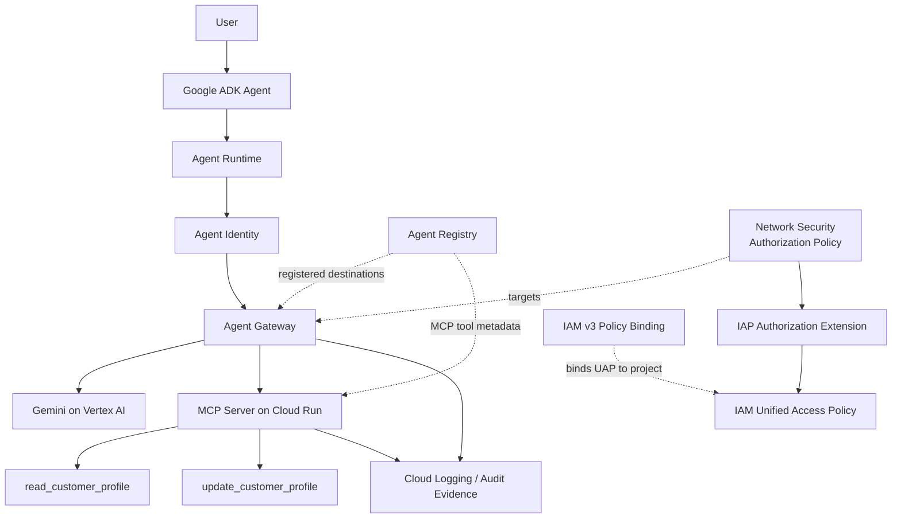
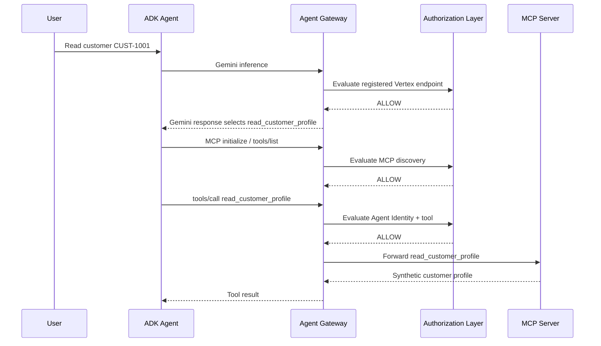
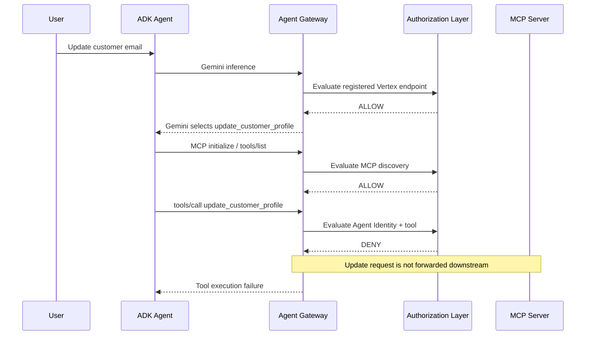
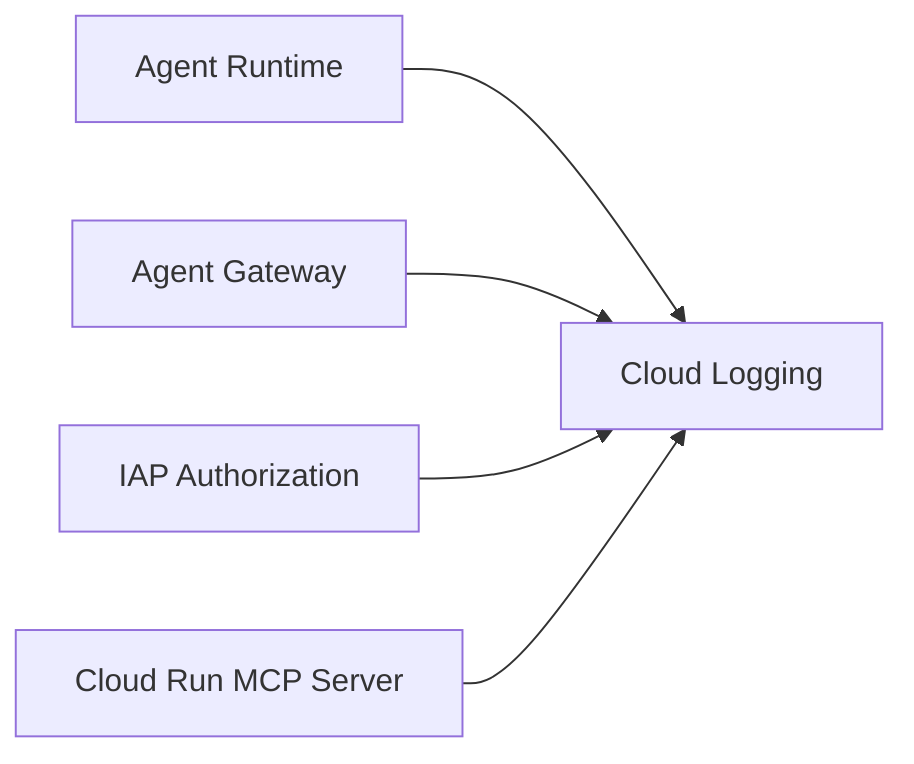

# Reference Architecture

This document describes the validated architecture of the Google Cloud Agent Gateway MCP Policy Lab.

The implementation demonstrates fine-grained authorization of MCP tool calls made by an AI agent running on Google Cloud Agent Runtime.

The key principle is:

> **The model proposes the action. The authorization layer determines whether that action may execute.**

---

## 1. High-level architecture



---

## 2. Execution model

The deployed agent runs on Agent Runtime using a dedicated Agent Identity.

The execution path begins as:

```text
User
  ↓
ADK Agent
  ↓
Agent Runtime
  ↓
Agent Identity
  ↓
Agent Gateway
```

From Agent Gateway, traffic can reach governed registered destinations such as:

```text
Vertex AI
MCP Server
```

Authorization is evaluated independently of the model's reasoning.

---

## 3. Governance model

Four distinct governance resources participate in the authorization design.

```text
Agent Gateway
  ↓
Network Security Authorization Policy
  ↓
IAP Authorization Extension
  ↓
IAM Unified Access Policy
  ↓
ALLOW / DENY
```

An IAM v3 Policy Binding attaches the UAP to the target project.

These resources serve different purposes and should not be treated as interchangeable.

---

## 4. Network Security Authorization Policy

The Network Security Authorization Policy attaches custom request authorization to the Agent Gateway.

Validated characteristics:

```text
policyProfile = REQUEST_AUTHZ
action        = CUSTOM
```

It targets the Agent Gateway and references the IAP Authorization Extension.

Repository artifact:

```text
policies/gateway-authz-policy.yaml
```

Conceptually:

```text
Agent Gateway
     ↓
REQUEST_AUTHZ
     ↓
CUSTOM provider
     ↓
IAP Authorization Extension
```

---

## 5. IAP Authorization Extension

The IAP Authorization Extension delegates authorization evaluation to IAP.

Validated configuration:

```text
service          = iap.googleapis.com
failOpen         = false
timeout          = 1s
iapPolicyVersion = V2
```

Repository artifact:

```text
policies/iap-authz-extension.yaml
```

The final `1s` timeout was regression-tested with both:

```text
read_customer_profile   → success
update_customer_profile → blocked
```

---

## 6. IAM Unified Access Policy

The Unified Access Policy contains the fine-grained authorization rules.

Repository artifact:

```text
policies/customer-profile-tools-uap.json
```

The UAP evaluates:

```text
Agent Identity
+
registered destination
+
destination resource type
+
MCP method
+
MCP tool name
```

The validated permission is:

```text
iap.googleapis.com/resources.egressViaIAP
```

---

## 7. UAP Policy Binding

The Unified Access Policy is bound to the project through an IAM v3 Policy Binding.

Repository artifact:

```text
policies/customer-profile-uap-binding.json
```

The relationship is:

```text
UAP
  ↓
Policy Binding
  ↓
Target project
```

Creating a UAP alone does not establish the target to which it applies.

---

## 8. Agent Identity

Agent Runtime is configured with:

```text
AGENT_IDENTITY
```

The UAP therefore evaluates the deployed agent as its own security principal.

The principal format used by the policy template is:

```text
${AGENT_PRINCIPAL}
```

This supports agent-specific least privilege rather than relying on one broadly shared identity.

---

## 9. Agent Registry

Agent Registry provides governed destination and tool metadata.

The lab registers the MCP server and its tools.

The tool metadata represented in:

```text
mcp-server/toolspec.json
```

contains:

```text
read_customer_profile
update_customer_profile
```

Registration does not itself grant authorization.

The distinction is:

```text
Registered
≠
Authorized
```

A registered tool can still be denied by UAP.

---

## 10. Vertex AI path

Gemini model inference is also governed through the Agent Gateway.

The validated UAP condition for registered Vertex endpoints is:

```text
destination.is_registered == true &&
destination.agent_registry.resource_type == 'ENDPOINT'
```

Validated flow:

```text
Agent Runtime
  ↓
Agent Identity
  ↓
Agent Gateway
  ↓
Authorization evaluation
  ↓
Registered Vertex AI endpoint
  ↓
Gemini
```

This traffic must remain authorized for the agent to perform reasoning before selecting MCP tools.

---

## 11. MCP protocol path

The MCP client performs protocol operations before executing a tool.

The observed sequence includes:

```text
initialize
notifications/initialized
tools/list
tools/call
```

Discovery and execution require different policy treatment.

The validated discovery condition is:

```text
destination.is_registered == true &&
destination.agent_registry.mcp_server.method != 'tools/call'
```

This permits protocol setup and discovery without granting arbitrary tool execution.

---

## 12. Tool-level authorization

The validated tool-level CEL structure is:

```text
destination.is_registered == true &&
destination.agent_registry.mcp_server.method == 'tools/call' &&
destination.agent_registry.mcp_server.tool.name == '<TOOL_NAME>'
```

The lab applies different effects to the two tools.

```text
read_customer_profile
→ ALLOW

update_customer_profile
→ DENY
```

---

## 13. Allowed read flow



Validated outcome:

```text
read_customer_profile
→ selected by Gemini
→ authorized
→ reached Cloud Run
→ executed successfully
→ result returned to agent
```

---

## 14. Denied update flow



Validated outcome:

```text
update_customer_profile
→ selected by Gemini
→ blocked by governance
→ did not reach Cloud Run as a tool execution
```

---

## 15. Downstream execution evidence

Authorization logs alone are not treated as sufficient proof of execution.

The validation correlates:

```text
Agent Runtime events
+
Agent Gateway logs
+
IAP audit logs
+
Cloud Run request logs
```

For the denied update test, Cloud Run received only:

```text
initialize
notifications/initialized
tools/list
```

There was no downstream request corresponding to the update tool execution.

This provided independent evidence that the mutation did not execute.

---

## 16. Logging architecture



Useful evidence comes from different layers.

### Agent Runtime

Shows:

```text
model response
function_call
function_response
final response
```

### Agent Gateway

Shows information such as:

```text
registered destination
MCP method
MCP parameter
authorization result
TLS interception
HTTP status
```

### IAP

Provides authorization evaluation evidence where emitted.

### Cloud Run

Provides the strongest downstream evidence that a request actually reached the MCP service.

---

## 17. Observability limitation

During validation, individual `tools/call` decisions were not always emitted as separate Gateway or IAP log records.

Therefore:

```text
absence of one log event
≠
proof that the architecture was bypassed
```

Validation should correlate the complete request timeline across multiple logging sources.

See:

```text
docs/validation.md
```

for the detailed evidence and queries.

---

## 18. Bound-token compatibility finding

The validated Runtime currently uses:

```text
GOOGLE_API_PREVENT_AGENT_TOKEN_SHARING_FOR_GCP_SERVICES=False
```

A controlled test changed only this value to:

```text
True
```

while leaving Gateway and UAP configuration unchanged.

Observed flow:

```text
Agent Runtime
  ↓
Agent Gateway
  ↓
Gateway authorization = ALLOWED
  ↓
aiplatform.mtls.googleapis.com
  ↓
Vertex AI = 401 UNAUTHENTICATED
```

After reverting to:

```text
False
```

the same read path succeeded again.

Therefore the observed failure is separate from the UAP authorization decision.

The detailed experiment is documented in:

```text
docs/validation.md
```

---

## 19. Security boundaries

The architecture intentionally separates several concerns.

### Reasoning

Handled by:

```text
Gemini + ADK
```

### Agent identity

Handled by:

```text
Agent Identity
```

### Destination registration

Handled by:

```text
Agent Registry
```

### Traffic interception and governance

Handled by:

```text
Agent Gateway
```

### Authorization attachment

Handled by:

```text
Network Security Authorization Policy
```

### IAP delegation

Handled by:

```text
IAP Authorization Extension
```

### Fine-grained authorization

Handled by:

```text
IAM Unified Access Policy
```

### Tool interface

Handled by:

```text
MCP
```

### Downstream execution

Handled by:

```text
Cloud Run MCP server
```

No single component performs all of these responsibilities.

---

## 20. Security principles

The validated design demonstrates:

### Tool discovery is not authorization

An agent can discover a tool without being allowed to execute it.

### Model intent is not permission

Gemini may decide that a tool would satisfy the request, but the model does not grant authorization.

### Authorization lives outside the prompt

Prompt instructions are behavioral guidance, not security controls.

### Least privilege applies per agent

Agent Identity allows policy to target the specific deployed agent.

### Tool-level policy is possible

Two tools exposed by the same MCP server can receive different authorization outcomes.

### Verify execution independently

Policy logs and downstream execution evidence should be correlated.

---

## 21. Policy lifecycle

The validated policy lifecycle is:

```text
Define
  ↓
Dry run / evaluate
  ↓
Observe
  ↓
Validate
  ↓
Enforce
  ↓
Verify downstream execution
```

Policy propagation may take several minutes.

A policy should not be repeatedly changed while propagation from the previous update may still be occurring.

---

## 22. Repository artifacts

```text
agent/
  agent.py
  runtime_app.py

deploy/
  deploy_agent.py

mcp-server/
  server.py
  toolspec.json

policies/
  iap-authz-extension.yaml
  gateway-authz-policy.yaml
  customer-profile-tools-uap.json
  customer-profile-uap-binding.json

docs/
  architecture.md
  validation.md
```

All cloud-environment-specific resource identifiers are represented using placeholders or environment variables rather than the identifiers from the environment used for validation.

---

## 23. Final validated baseline

```text
Agent Runtime                         PASS
Agent Identity                        ACTIVE
Agent Gateway                         ENFORCE
Agent Registry MCP destination        REGISTERED

IAP Policy Version                    V2
IAP Authorization timeout             1s
IAP fail-open                         false

Registered Vertex endpoint            ALLOWED

MCP initialize                        ALLOWED
MCP notifications/initialized         ALLOWED
MCP tools/list                        ALLOWED

read_customer_profile                 ALLOWED + EXECUTED
update_customer_profile               DENIED + NOT EXECUTED

Bound-token protection                False
Final read regression                 PASS
Final update-deny regression          PASS
```

This represents the known-good reference architecture validated by this lab.
